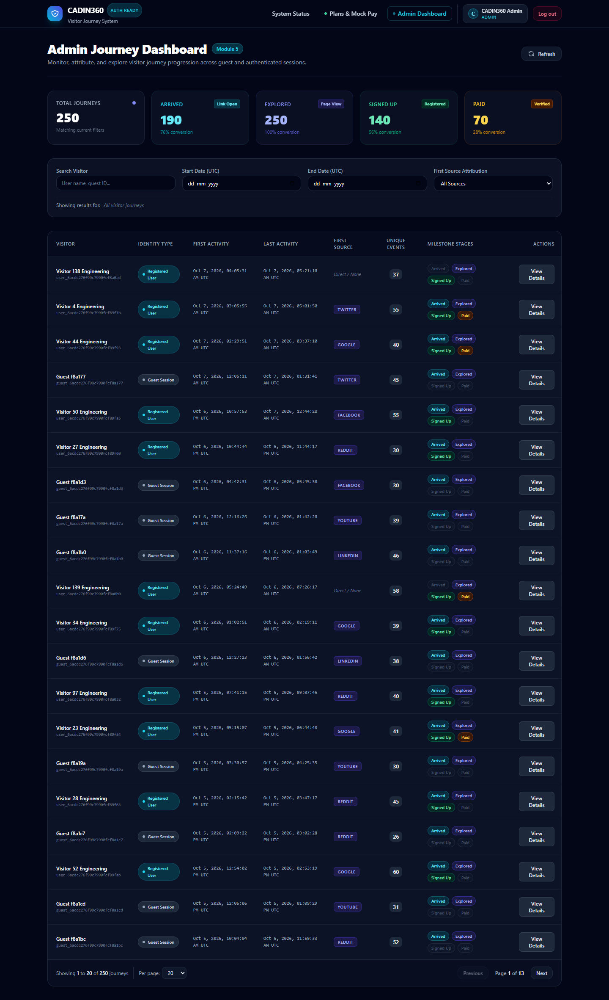
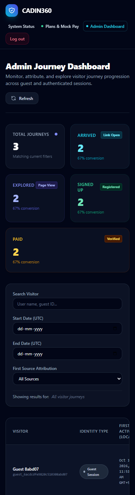

# CADIN360 Visitor Journey

A MERN application that tracks a visitor from the first link open through browsing, signup, and a verified mock payment. Guests appear in the admin dashboard before signup; when they register, their earlier activity joins the user journey.

## What it does

- Records guest and signed-in activity with idempotent event IDs. Duplicate or concurrent retries do not increase event counts.
- Joins one or more guest sessions to a registered user without copying historical events.
- Derives Arrived, Explored, Signed Up, and Paid milestones independently from the full journey history. Only a server-verified mock payment reaches Paid.
- Shows an admin journey list with search, source and date filters, summary totals, and pagination, plus a chronological detail timeline.
- Supports mobile layouts and loading, empty, error, and retry states.

## Stack

| Client | Server | Database |
| --- | --- | --- |
| React, Vite, React Router, Tailwind CSS | Node.js, Express, Mongoose, JWT | MongoDB |

## Run locally

Requirements: Node.js, npm, and a running MongoDB instance.

```powershell
npm install
Copy-Item server/.env.example server/.env
Copy-Item client/.env.example client/.env
npm run dev
```

Edit `server/.env` if MongoDB is at a different address. The default application database is `cadin360_visitor_journey`. The client runs at `http://localhost:5173` and the API at `http://localhost:5000`.

To create the local admin account configured in `server/.env`:

```powershell
npm run seed:admin -w server
```

The registration page also offers an Admin role. Selecting it currently grants admin access without a separate admin secret. Use this project in a trusted local/demo environment.

## Demo data and query plans

```powershell
npm run seed
npm run explain
```

`npm run seed` targets more than 10,000 events across 250 generated journeys in the database named by `MONGODB_URI`; actual counts vary because the generator samples activity. It preserves existing records. Run it against a separate database if you want to keep working data apart from fixtures. `npm run seed:reset` removes existing events, guest sessions, payment attempts, and standard users in that database before reseeding; it is intended only for disposable local data.

The latest local application database verification recorded **10,768 events and 253 journeys**. Event indexes support user and guest timelines, date sorting, and unique event IDs. Measured `explain("executionStats")` output and index details are in [SUBMISSION.md](./SUBMISSION.md). Local database contents are not stored in this GitHub repository.

## Tests and build

```powershell
npm test
npm run build
```

The current suite has **124 server tests and 16 client tests**. It covers retries, delayed events, guest ownership and merging, admin access, payment verification, route labels, filtering, and pagination. Test case details are in [SUBMISSION.md](./SUBMISSION.md).

## Main routes

| Page | Purpose |
| --- | --- |
| `/` | Visitor landing page and event tracking |
| `/register`, `/login` | Account creation and sign-in |
| `/plans` | Mock payment flow |
| `/admin/journeys` | Admin journey dashboard |
| `/admin/journeys/:journeyId` | Journey milestones and timeline |

The API is under `/api`. A request collection is available in [cadin360.postman_collection.json](./cadin360.postman_collection.json).

## Screenshots

| Admin dashboard | Mobile dashboard |
| --- | --- |
|  |  |

More screenshots: [home](./screenshots/home.png), [login](./screenshots/login.png), and [journey details](./screenshots/journey-details.png).
